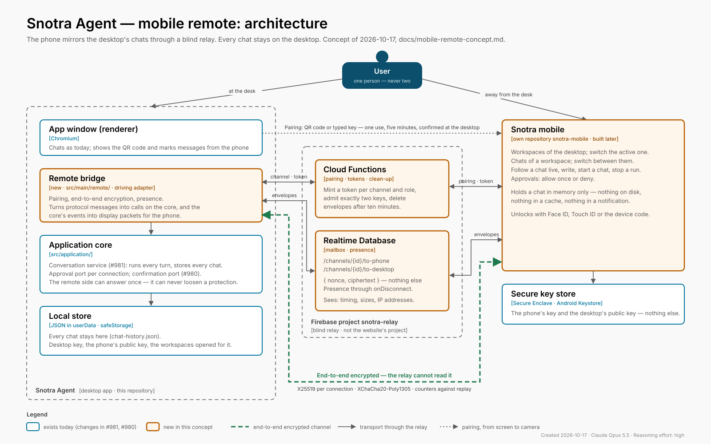

# Mobile remote: a phone as a window into the desktop's chats

Concept, written on 2026-10-17 ([#1082](https://github.com/kkrafft1999/snotra/issues/1082), epic [#1081](https://github.com/kkrafft1999/snotra/issues/1081)). Nothing of it is built yet. The mobile app
itself is implemented later, in a repository of its own; this document settles
what the desktop, the relay and the app have to agree on before any of them is
written. Diagram: [`mobile-remote-architecture.svg`](./mobile-remote-architecture.svg).

Revised on 2026-10-17, the same day: the app is a native iPhone app in Swift
and SwiftUI, in [`kkrafft1999/snotra-mobile`](https://github.com/kkrafft1999/snotra-mobile),
and the encryption is built from CryptoKit on the phone and Node's built-in
`crypto` on the desktop — ChaCha20-Poly1305 instead of XChaCha20, no libsodium
([§5.2](#52-the-channel), [§8](#8-the-mobile-app)).

It changes two decisions of [`quality-requirements.md`](./quality-requirements.md)
from 2026-10-15 — *no backend of our own* and *remote control over localhost
only* — and the reasons are in [§3](#3-what-changes-in-the-quality-requirements).

## 1. What the user gets

Konrad works at the desktop in one or more workspaces and has to leave the
machine. A chat is still running, or waiting for an approval, or he wants to
ask one more thing. With the phone he can:

- see the workspaces he has opened for remote access, and switch the desktop to
  one of them;
- see the chats of a workspace and switch between them;
- read a chat as it stands on the desktop, and follow a running answer live;
- write a message, start a new chat, stop a run;
- answer a tool approval with *allow once* or *deny*.

The phone is a **mirror**, not a second copy. Every chat stays on the desktop,
is run there and is stored there. The phone holds what is on its screen in
memory and nothing more.

## 2. Ground rules

These are the decisions the rest of the concept follows from. The first five
come from the user, the rest are what they imply.

| # | Rule | Source |
| - | ---- | ------ |
| R1 | **One user.** The phone is a further way in for the person at the desktop, never a second person's. Multi-user operation stays a non-goal and is prevented technically, not only left out. | User, 2026-10-17 |
| R2 | **Chats live on the desktop.** The desktop runs every turn and stores every chat. The phone stores no chat content — not on disk, not in a cache, not in a notification. | User |
| R3 | **Pairing only with what the desktop shows.** A phone joins only by scanning the QR code on the desktop screen, or by typing the key shown next to it. No account, no e-mail link, no code sent elsewhere. | User |
| R4 | **The relay is blind.** The Firebase relay moves end-to-end encrypted packets between exactly two keys and can read none of them. | User (Firebase), decision 2026-10-17 (blind) |
| R5 | **The phone answers approvals once, and never loosens a protection.** *Allow once* and *deny* work from the phone. Auto mode, *always allow*, *allow for this workspace*, a sandbox opt-out, a new program allowance: only at the desktop, in person. | Decision 2026-10-17, [#980](https://github.com/kkrafft1999/snotra/issues/980) |
| R6 | **The phone may switch the desktop's workspace**, but only to one the user opened for remote access, and never in the middle of a run. | Decision 2026-10-17 |
| R7 | **Off by default.** Nothing listens, nothing connects and nothing goes to Firebase until the user pairs a phone. Unpairing removes the channel on the relay. | Privacy goal, §2 of the quality requirements |
| R8 | **No silent state.** The desktop always shows when a phone is connected; the phone always shows whether the desktop is reachable. | "Silent misbehaviour is the worst failure" |

## 3. What changes in the quality requirements

The architecture review agreed on 2026-10-15 that remote control reaches the
core over localhost only, and that Snotra has no server of its own. A relay in
Firebase is a server of ours, and a phone on the mobile network is not on
localhost. Two ways would have kept the old rules:

- **A tunnel the user sets up** (Tailscale, WireGuard, an SSH forward). Keeps
  the rules, but asks for network administration that most users don't do, and
  a phone app that works only behind a VPN is no app.
- **A relay that sees everything** (TLS to Firebase, plain text there). The
  simplest to build — and chats would sit readable on Google's servers.

The decision is the third way: a **blind relay**. It is a backend in the
operational sense — it runs, it costs, it can fail — but not in the sense the
rule was written against: it holds no account, no chat, no key, no telemetry,
and what it stores it cannot read. `quality-requirements.md` is amended to
that effect, with the date, in the same pull request as this concept. Scenario
SEC-5 keeps its localhost rule for the local interface of
[#989](https://github.com/kkrafft1999/snotra/issues/989), and a new scenario
SEC-6 covers the relay.

## 4. The pieces



| Piece | Where it lives | Holds | Does |
| ----- | -------------- | ----- | ---- |
| **Remote bridge** | This repository, `src/main/remote/` (driving adapter) and `src/application/` (the parts that decide) | The desktop's identity key (in `safeStorage`), the paired phone's public key, the per-workspace release | Pairing, encryption, translating protocol messages into calls on the conversation service and back; the presence indicator |
| **Relay** | A Firebase project of its own (`snotra-relay`), **not** the website's project | Channel records and encrypted envelopes with a short time to live | Pairing endpoints, minting access tokens, carrying envelopes both ways, presence, clean-up |
| **Mobile app** | Its own repository, [`snotra-mobile`](https://github.com/kkrafft1999/snotra-mobile) — Swift and SwiftUI, iPhone first, implemented later | The phone's identity keys (in the Secure Enclave), the desktop's public keys and the channel id (Keychain, this device only) — nothing else on disk | Shows and drives what the desktop sends |
| **Protocol** | This repository: `docs/remote-protocol.md` and `src/shared/contracts/remote/`, with test vectors | — | The contract all three follow, versioned |

Why the protocol lives here: the desktop is the authority on what a chat is and
what a front end may do. The mobile repository pins a protocol version and runs
the test vectors from here; the relay never needs to understand it.

Why the relay is not in the website's Firebase project: the rule in
[`task-management.md`](../.claude/rules/task-management.md) — nothing here
depends on the website — holds the other way round as well. A broken deploy of
the website must not take the relay down, and a relay quota must not take the
website down.

### 4.1 Desktop: the remote bridge is a second front end

The phone is the first front end that is not the renderer. That is exactly the
case three findings of the architecture review were written for, and they are
**prerequisites**, not side work:

- **[#981](https://github.com/kkrafft1999/snotra/issues/981) — the
  conversation moves into the core.** Today the renderer owns the run registry,
  persistence, the cost sum and the title trigger, and sends the whole history
  with every turn. A message from the phone would have to be routed through the
  renderer to become a turn — through a window that may be minimised, reloading
  or showing another chat. The bridge therefore waits for the conversation
  service in `src/application/`: it sends a chat id and a message, and receives
  the same events the renderer receives.
- **[#980](https://github.com/kkrafft1999/snotra/issues/980) — loosening only
  through a confirmation port with user presence.** The remote adapter of that
  port answers every request with *no*. That is R5, enforced by the core rather
  than by the phone app's good manners.
- **[#989](https://github.com/kkrafft1999/snotra/issues/989) — the remote
  interface.** Its channel catalogue (request, response, push and error schemas)
  and the *connection id* that replaces the `webContents` id are what the
  remote protocol is built from. This concept widens #989: the transport is the
  relay, and its threat model has to cover a network attacker, not only a local
  process.

Inside main, the bridge is wired in the composition root like any other driving
adapter. What it needs from the rest of the app:

- **Approvals per connection.** `tool-approval-adapter.js` keeps one
  subscriber per `webContents`. It becomes one subscriber per *connection*, and
  a request goes to every front end that shows its chat — the window and the
  phone. The first answer wins; the other side receives the `resolved` push and
  removes its card. The remote connection is offered only *allow once* and
  *deny*; an *always* that arrives from it anyway is refused in the core.
- **Workspace activation from the phone.** The phone asks; the bridge calls
  `activateKnownFolder` with a path from the release list — never a path the
  phone sends. It is refused while a run in the current workspace is working or
  waiting for an approval (the phone says why). The desktop shows a banner:
  *Switched to "Project X" from your phone.*
- **Events the desktop window shows too.** A message written on the phone
  appears in the desktop's chat as it is sent, with a small phone mark; a chat
  the phone opens does not change the chat on the desktop's screen.
- **Staying awake.** While a phone is connected and a run is working, the
  desktop holds a `powerSaveBlocker` so the machine doesn't sleep mid-answer.
  Beyond that, a sleeping or closed desktop is simply offline (R8).

### 4.2 Relay: Firebase as a mailbox, Functions as the door

A Cloud Function on its own can't carry a conversation: it answers a request
and ends, and two calls of it may land on different instances that know nothing
of each other. The bidirectional channel needs a store both sides listen on.
Three ways to build it:

| Option | How | Cost of a streaming answer | Fit |
| ------ | --- | -------------------------- | --- |
| **A. Realtime Database + Functions** *(recommended)* | Each side writes envelopes into its outbox under `/channels/{id}/` and listens on the other side's. Functions do pairing, tokens and clean-up; `onDisconnect` gives presence for free. | Billed by data volume, not by writes — a delta every 150 ms is cheap | Best: low latency, presence built in, small free tier is enough for one user |
| B. Firestore + Functions | Same, with documents and snapshot listeners | Billed per write; a streamed answer is hundreds of writes, the free tier runs out after about an hour of streaming a day | Works, costs more, no presence |
| C. Cloud Run with WebSockets | A real relay server holding both sockets | Instance time while connected | Most control, but a server to operate and scale, and two instances still need a broker between them |

**Recommendation: A.** It is the closest to what was asked for — Firebase, a
Function that opens the channel — without asking a Function to do what it
can't. The desktop talks to the database over its REST streaming interface
(server-sent events), so main needs no Firebase SDK; the phone uses the native
SDK.

What the relay stores:

```
/channels/{channelId}
    desktopKeys     public keys of the desktop (P-256: signing, key agreement)
    phoneKeys       public keys of the phone, empty until paired
    createdAt, lastSeen
/channels/{channelId}/presence/{desktop|phone}   online flag, via onDisconnect
/channels/{channelId}/to-phone/{seq}             { nonce, ciphertext, expiresAt }
/channels/{channelId}/to-desktop/{seq}           { nonce, ciphertext, expiresAt }
/pairing/{pairingId}                             one-time, 5 minutes
```

- **Access.** No accounts. A Function mints a Firebase custom token whose claims
  name the channel and the role (`desktop` or `phone`), after the caller has
  proved it holds the private key of that role (a signed challenge). The
  security rules let a token read and write its own channel only, write only
  into its own outbox, and never read `/pairing` at all.
- **Two keys, no third.** Once `phoneKeys` are set, the Function refuses another
  claim on the channel. A new pairing creates a new channel and deletes the
  old one (R1).
- **Short life.** The receiver deletes an envelope once it has read it; a
  scheduled Function deletes whatever is older than ten minutes, and channels
  nobody has seen for 30 days.
- **Abuse.** App Check (App Attest) on the pairing endpoint,
  a rate limit per IP, size limits on envelopes, and a budget alert on the
  project. None of it protects a chat — encryption does — it protects the bill.

What the relay can see is listed in [§6](#6-threat-model).

## 5. Pairing and encryption

### 5.1 Pairing

Pairing joins one phone to one desktop installation. It happens once per
phone, not once per workspace.

1. **Desktop.** *Settings › Remote access › Pair a phone.* The desktop creates
   a channel on the relay with its public key and receives a pairing id. It
   draws a QR code and, beneath it, the same content as a typed key:

   ```
   snotra-pair:v1/<relay>/<pairingId>/<pairingSecret>
   key: 7KQM-3XWD-P9TA-HV2N-RC6E   (pairing id and secret, Crockford base32)
   ```

   The pairing secret is 128 random bits, valid for **five minutes and one
   use**. It never reaches the relay.
2. **Phone.** Scans the code or takes the typed key. It generates its own
   keys in the Secure Enclave and sends the public halves to the pairing
   endpoint, together with a MAC (HMAC-SHA256) over its own and the desktop's
   public keys under the pairing secret. The relay stores them and cannot
   forge the MAC: it doesn't know the secret.
3. **Desktop.** Checks the MAC. A wrong MAC — a relay or a stranger trying to
   slip in its own keys — ends the pairing with an error.
4. **Both** derive the same six-word safety phrase from both sides' public keys
   and show it.
5. **Desktop, in person.** *"iPhone wants to access Snotra. The phone shows:
   amber · lantern · seven · orbit · velvet · quay. Allow?"* Only this click
   completes the pairing. A photographed QR code is therefore not enough: it
   needs someone at the desktop to confirm it within five minutes.

From then on the phone authenticates with its key; there is no password to
lose and no code to reuse.

Opening workspaces for the phone is a separate switch per workspace —
*Settings › Tools & security › Access from your phone* — so a workspace with
sensitive material can stay invisible to the phone even when another one is
open. The first time the switch is turned on without a paired phone, it leads
into the pairing above. That keeps the gesture as it was imagined — connect the
phone to this workspace — while the phone only has to be scanned once.

### 5.2 The channel

- **Identity.** Each side holds two long-term P-256 keys: one to sign (it
  proves the role to the relay's token Function) and one for key agreement.
  On the phone both live in the **Secure Enclave** and cannot be exported; on
  the desktop they are stored through `safeStorage`. P-256 rather than
  Curve25519 for these, because the Secure Enclave knows only P-256.
- **Session keys.** Every connection starts with a fresh X25519 pair on each
  side. HKDF-SHA256 mixes the static P-256 agreement (who is talking) with the
  ephemeral X25519 agreement (forward secrecy) and the handshake transcript,
  and derives one key per direction. A stolen long-term key does not decrypt
  past connections.
- **Packets.** ChaCha20-Poly1305 in its IETF form with a 96-bit nonce: a
  64-bit per-direction counter, padded. Since every connection and direction
  has its own key, a nonce never repeats under a key — the reason XChaCha20's
  random 192-bit nonces aren't needed. A packet that is replayed, reordered
  beyond a small window, or altered is dropped, and the connection is
  re-established.
- **Libraries.** None from third parties: **CryptoKit** on the phone
  (`P256.Signing`, `SecureEnclave.P256.KeyAgreement`, `Curve25519.KeyAgreement`,
  `HKDF`, `ChaChaPoly`), Node's built-in **`crypto`** in main (`ecdh`/`sign`
  on `prime256v1`, `x25519`, `hkdf`, `chacha20-poly1305`). Both are covered by
  the shared test vectors of the protocol. Before building, the handshake is
  checked against the Noise `KK` pattern, which it follows in spirit — if it
  can be written as Noise with these primitives, it is.
- **Version.** The first packet names the protocol version; a version the
  desktop doesn't speak ends the connection with a message the phone can show.

### 5.3 Ending it

- *Settings › Remote access › Remove phone* deletes the phone's key on the
  desktop and the channel on the relay. The phone loses access immediately.
- Pairing a new phone removes the old one (R1). The desktop says so before it
  starts.
- The app on the phone has *Disconnect*, which deletes its keys.
- A channel unused for 30 days is deleted on the relay; the desktop then shows
  the phone as removed.

## 6. Threat model

The attacker model of [`security-concept.md`](./security-concept.md) §5 puts
local processes outside the goal. The relay adds a network attacker, and the
operator of the relay — Google, or whoever gets into the Firebase project.

| Threat | What stops it |
| ------ | ------------- |
| The relay, or someone inside the Firebase project, reads chats | End-to-end encryption; the relay never holds a private key or the pairing secret |
| The relay injects or alters messages | AEAD with counters; a forged packet doesn't authenticate |
| The relay swaps in its own key during pairing | MAC under the pairing secret, then the safety phrase confirmed at the desktop |
| Someone photographs the QR code | One use, five minutes, and the pairing completes only with a click at the desktop |
| **A second person uses Snotra through the phone** (R1) | One phone per installation; a new pairing removes the old one; the channel admits exactly two keys; pairing needs presence at the desktop |
| A stolen or lost phone | *Remove phone* at the desktop; the app asks for Face ID / Touch ID / the device code when it opens and after 5 minutes in the background |
| The phone loosens a protection | Not offered, and refused in the core (#980); only *allow once* / *deny* |
| The phone reaches files outside a released workspace | The phone sends ids, never paths; activation only from the release list; the workspace stays the trust boundary of #68 |
| A prompt injection in a chat reaches the phone | The phone renders Markdown with the same sanitizing rules as the desktop, no remote images, no HTML |
| Chat content left on the phone | Memory only; the app switcher snapshot is blurred; no content in notifications |
| The relay is down | The desktop is unaffected — the remote feature is off until it comes back, and the phone says so |
| Abuse of the relay, a large bill | App Check, rate limits, envelope size limits, TTL clean-up, budget alert |

**What the relay does see**, and the privacy notice of the app has to say so:
that a channel exists; when each side is online; the time and size of every
packet; the IP addresses of desktop and phone. From the sizes and the timing it
can guess *that* a long answer is streaming, never *what* it says.

## 7. The protocol

Specified in detail in `docs/remote-protocol.md` once
[#989](https://github.com/kkrafft1999/snotra/issues/989) has settled the
channel catalogue. The shape, as far as this concept needs it:

**Phone → desktop**

| Message | What it does |
| ------- | ------------ |
| `hello` | Protocol version, app version, language of the phone |
| `workspaces.list` | The released workspaces, which one is active |
| `workspace.activate` | Switch the desktop to a released workspace (R6) |
| `chats.list` | Chats of the active workspace: id, title, time, running/needs approval |
| `chat.open` | Subscribe to one chat; the answer is a snapshot of its last 30 messages |
| `chat.more` | Older messages, page by page |
| `chat.new` | A new chat in the active workspace |
| `message.send` | A message into a chat — becomes a turn on the desktop |
| `run.abort` | Stop the chat's run |
| `approval.respond` | `allow-once` or `deny` for a pending request |

**Desktop → phone**

| Message | What it says |
| ------- | ------------ |
| `state` | Active workspace, running chats, whether the desktop is busy |
| `chat.snapshot` | Messages as display DTOs — Markdown text, tool lines already formatted by `shared/presentation/tool-display.js`, no raw tool payloads |
| `chat.delta` | Streamed text, batched every 150 ms into one packet |
| `chat.tool-line`, `chat.progress`, `chat.run-end` | As the renderer gets them (see *Runs per chat* in `architecture.md`) |
| `approval.request`, `approval.resolved` | The same card the desktop shows, with the options the phone may use |
| `error` | An error key from the catalogue (`src/shared/i18n/`), translated on the phone |

Two rules carry the rest:

- **The phone sends ids, the desktop decides.** No path, no tool payload, no
  setting reaches the desktop from the phone.
- **The desktop sends what it would show, not what it holds.** Display DTOs,
  like the renderer receives — the phone needs no provider knowledge and no
  history to resend.

Images and attachments in a chat are left out of the first version; the
snapshot carries a placeholder (*Image — open on the desktop*). They can follow
as encrypted, size-capped thumbnails on demand.

## 8. The mobile app

Built later, in `snotra-mobile`. What this concept asks of it:

- **Screens:** pairing (camera, typed key, safety phrase), workspaces, chats of
  a workspace, a chat with composer and approval cards, connection state.
- **Stores nothing but its keys.** No chat in a database, a file or a cache;
  everything is gone when the app is closed.
- **Bilingual**, English and German, under the rules of
  [`language.md`](../.claude/rules/language.md).
- **Same standard** as the desktop under
  [`ux-ui-standards.md`](../.claude/rules/ux-ui-standards.md): every state —
  desktop offline, relay unreachable, workspace not released, run waiting for
  approval, approval answered on the desktop — has its own screen or note.
- **Platform: iPhone, native** (decided 2026-10-17). Swift and SwiftUI, with
  what the system brings: CryptoKit and the Secure Enclave for the keys,
  VisionKit (`DataScannerViewController`) for the QR scan, LocalAuthentication
  for Face ID, the Firebase iOS SDK for the Realtime Database. React Native
  with Expo was the alternative — one language with the desktop and Android
  almost for free — and lost on the two things the concept rests on: the
  encryption comes from the platform instead of a third-party binding, and the
  app looks and behaves like an iPhone app. Android is not planned; the
  protocol does not depend on the platform, so it stays possible.
- **Building it needs Xcode** on the Mac (not installed as of 2026-10-17) and
  the Apple Developer Program for TestFlight and the user's own iPhone.

**Push notifications** — *"Snotra needs your approval"* while the app is closed
— are a sensible second step, not part of the first. They need FCM/APNs, which
adds metadata at Google or Apple. They would carry no content at all: the
desktop pings the relay, a Function sends an empty "open the app" notification,
the app fetches the actual card over the channel.

## 9. Phases

| Phase | What | Where | Depends on |
| ----- | ---- | ----- | ---------- |
| 0 | Conversation in the core (#981), confirmation port (#980), remote interface ADR widened to the relay (#989) | here | — |
| 1 | Protocol spec and test vectors; remote bridge with pairing, encryption, presence; desktop UI (*Settings › Remote access*, workspace switch, connection indicator, phone mark on messages) | here | 0 |
| 2 | Relay: Firebase project, Functions, database rules, clean-up; tested against the Firebase emulator | relay | 1 (protocol) |
| 3 | A small reference client in Node in this repository's `e2e/` that pairs and chats through the emulator — the desktop's end-to-end test, and the mobile app's reference | here | 1, 2 |
| 4 | Mobile app MVP | `snotra-mobile` | 1–3 |
| 5 | Push notifications, images, a second device for the same user (if ever wanted) | all | 4 |

Phase 3 matters: it lets the desktop side be finished and tested before a
single line of the mobile app exists, and gives that app a client to compare
against.

## 10. Open points

- **The relay's code:** its own repository, or a `relay/` folder in
  `snotra-mobile`. The relay is small and protocol-blind, so either works; it
  must not live in the website's project (§4).
- **A second device of the same user** (phone and tablet). R1 allows it in
  principle — it is still one person — but one device keeps the rule simple to
  check. The first version allows one.
- **What the desktop does on a phone message while the user sits in front of
  it** — nothing special is planned; the message appears in the chat with its
  phone mark.
- **Privacy notice** on the website (not in this repository) once the relay is
  live, listing what §6 says the relay sees.
- **Cost ceiling.** The Firebase project needs a budget and a decision on what
  happens when it is reached — a relay that stops is acceptable, a bill that
  grows is not.
